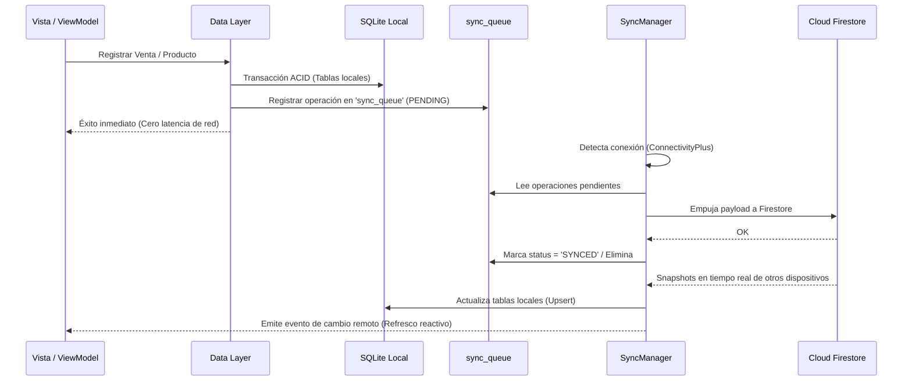

# 📐 Arquitectura y Lógica del Sistema — Electronic Store

Este documento describe en detalle la arquitectura de software, patrones de diseño, flujo de datos, modelo de sincronización offline-first y las reglas de negocio clave implementadas en el proyecto **Electronic Store**.

---

## 📑 Tabla de Contenidos
1. [Visión General del Sistema](#1-visión-general-del-sistema)
2. [Patrón de Arquitectura (Clean Architecture)](#2-patrón-de-arquitectura-clean-architecture)
3. [Estructura del Proyecto y Módulos](#3-estructura-del-proyecto-y-módulos)
4. [Flujo de Datos y Gestión de Estado](#4-flujo-de-datos-y-gestión-de-estado)
5. [Estrategia Offline-First y Sincronización en Tiempo Real](#5-estrategia-offline-first-y-sincronización-en-tiempo-real)
6. [Reglas de Negocio Críticas (Core Logic)](#6-reglas-de-negocio-críticas-core-logic)
7. [Base de Datos Local (SQLite)](#7-base-de-datos-local-sqlite)
8. [Autenticación y Roles de Usuario](#8-autenticación-y-roles-de-usuario)
9. [Flujo Extremo a Extremo de una Venta (End-to-End)](#9-flujo-extremo-a-extremo-de-una-venta-end-to-end)

---

## 1. Visión General del Sistema

**Electronic Store** es una solución móvil/desktop para punto de venta (POS) y gestión de inventario para comercios de electrónica/tecnología. 

### Principios Fundamentales:
* **Offline-First Robusto:** La aplicación opera 100% de manera autónoma sin conexión a internet leyendo y escribiendo sobre SQLite local.
* **Sincronización Bidireccional en Tiempo Real:** Al reconectarse, sincroniza cambios locales hacia Google Cloud Firestore y consume cambios remotos de otros terminales concurrentemente.
* **Protección Anti-Pérdida (Anti-Loss Engine):** Ninguna venta puede cerrarse por debajo del costo real del lote asociado.
* **Control de Inventario FIFO:** Las ventas consumen inventario ordenado por fecha de adquisición de lotes (`purchase_date ASC`), admitiendo segmentación física de stock por ubicación (`ALMACEN` vs `TIENDA`).

---

## 2. Patrón de Arquitectura (Clean Architecture)

El proyecto sigue estrictamente los principios de **Clean Architecture** (Arquitectura Limpia) junto con el patrón **MVVM (Model-View-ViewModel)** mediante `Provider`:

```
┌─────────────────────────────────────────────────────────────┐
│                     PRESENTATION LAYER                      │
│     Widgets (Views)  ◄───►  ViewModels (ChangeNotifier)     │
└──────────────────────────────▲──────────────────────────────┘
                               │ Invoca UseCases
┌──────────────────────────────▼──────────────────────────────┐
│                        DOMAIN LAYER                         │
│   UseCases (Reglas de Negocio)  ◄───►  Entities (Modelos)   │
│              Repository Interfaces (Contratos)              │
└──────────────────────────────▲──────────────────────────────┘
                               │ Implementado por
┌──────────────────────────────▼──────────────────────────────┐
│                         DATA LAYER                          │
│     Repository Implementations  ◄───►  Models (Mapeos)      │
│   DataSources Locales (SQLite)  │  Remote (Firestore)       │
└─────────────────────────────────────────────────────────────┘
```

### Separación de Responsabilidades:

1. **Presentation Layer (`features/<feature>/presentation`)**:
   - **Views / Screens:** Interfaz de usuario declarativa en Flutter.
   - **ViewModels:** Administradores de estado reactivo (`ChangeNotifier`) que transforman datos para la UI, invocan casos de uso y manejan errores visuales.
   - **Widgets:** Componentes reutilizables encapsulados.

2. **Domain Layer (`features/<feature>/domain`)**:
   - **Entities:** Objetos de negocio inmutables puros (heredan de `Equatable`). No dependen de librerías de persistencia ni de Flutter.
   - **Use Cases:** Una única tarea de negocio por clase (ej: `CreateSale`, `ConsumeStockFifo`, `RegisterSellerUseCase`). Retornan `Either<Failure, T>` usando la librería funcional `dartz`.
   - **Repository Interfaces:** Contratos abstractos que definen las operaciones requeridas por el dominio sin acoplarse a fuentes de datos.

3. **Data Layer (`features/<feature>/data`)**:
   - **Models:** Extienden o mapean entidades añadiendo serialización `fromMap()`, `toMap()`, `fromFirestore()`, etc.
   - **Data Sources:** 
     - *Local:* Acceso a SQLite mediante `DatabaseHelper` y transacciones ACID.
     - *Remote:* Acceso a Cloud Firestore.
   - **Repository Implementations:** Orquestan qué data source consultar, transforman excepciones técnicas en fallos de dominio (`Failure`) y encolan operaciones si es necesario.

---

## 3. Estructura del Proyecto y Módulos

```
lib/
├── core/                         # Infraestructura transversal
│   ├── constants/                # Constantes de DB y configuración
│   ├── database/                 # SQLite DatabaseHelper y migraciones
│   ├── errors/                   # Failures y Excepciones personalizadas
│   ├── sync/                     # Motor de sincronización Offline/Online
│   │   ├── data/                 # SyncLocalDataSource, FirestoreRemoteDataSource
│   │   └── domain/               # SyncManager (gestor de colas y listeners)
│   ├── theme/                    # Tokens de diseño y colores
│   └── usecases/                 # Definición base de UseCase<Type, Params>
│
├── features/                     # Módulos organizados por dominio funcional
│   ├── auth/                     # Autenticación con PIN, roles (Admin/Seller)
│   ├── clients/                  # Directorio de clientes recurrentes
│   ├── dashboard/                # Métricas financieras, arqueo de caja y balances
│   ├── deliveries/               # Gestión de repartidores y rutas
│   ├── inventory/                # Catálogo, lotes FIFO, costos y stock
│   ├── main/                     # Shell principal de navegación (HomeShellView)
│   ├── pos/                      # Punto de venta (carrito, cobro, prevención de pérdidas)
│   └── promoters/                # Vendedores y promotores asociados a ventas
│
├── firebase_options.dart         # Credenciales de inicialización Firebase
└── main.dart                     # Inyección de dependencias y arranque
```

---

## 4. Flujo de Datos y Gestión de Estado

La inyección de dependencias se realiza en el arranque en [main.dart](file:///d:/proyectos/electronic_store/lib/main.dart) a través de un `MultiProvider`:

```
User Interaction (View)
       │
       ▼
ViewModel.ejecutarAccion()
       │
       ▼
UseCase.call(Params)
       │
       ▼
RepositoryImpl.operacion()
   ├──► DataSourceLocal (SQLite txn + sync_queue)
   └──► Return Either<Failure, Success>
       │
       ▼
ViewModel actualiza estado + notifyListeners()
       │
       ▼
View se redibuja reactivamente
```

Para el manejo de errores se utiliza programación funcional:
* `Right(resultado)`: Operación exitosa.
* `Left(Failure)`: Operación fallida (`ValidationFailure`, `DatabaseFailure`, `AuthFailure`, etc.).

---

## 5. Estrategia Offline-First y Sincronización en Tiempo Real

El sistema implementa una arquitectura **Offline-First con Outbox Pattern (`sync_queue`)** orquestada por `SyncManager`.



### Características de la Sincronización:
1. **Transacciones Locales Atómicas:** Cada operación local (crear venta, agregar lote, registrar cliente) actualiza las tablas maestras y registra una entrada en `sync_queue` dentro de la **misma transacción SQLite**.
2. **Cola de Envíos Pendientes:** Si no hay internet, la operación queda guardada en `sync_queue` con reintentos exponenciales y estado `PENDING`.
3. **Suscripción en Tiempo Real Multi-Dispositivo:** `SyncManager.startRealtimeSync()` mantiene streams activos sobre colecciones de Firestore:
   * `products`
   * `lots`
   * `sales`
   * `clients`
   * `deliveries`
   * `users`
4. **Resolución de Conflictos:** Estrategia basada en marcas temporales de cliente (`clientTimestamp` y `lastModified`) garantizando consistencia eventual.

---

## 6. Reglas de Negocio Críticas (Core Logic)

### A. Consumo de Inventario FIFO (First-In, First-Out)
El inventario no se maneja como un simple contador unitario; cada producto tiene **lotes independientes** (`lots`):
* Cada lote almacena: `current_quantity`, `real_unit_cost`, `purchase_date`, `location` (`ALMACEN` o `TIENDA`).
* Al vender un producto, el sistema busca los lotes disponibles activos ordenados cronológicamente:
  ```sql
  SELECT * FROM lots 
  WHERE product_id = ? AND current_quantity > 0 AND is_active = 1 AND location = ?
  ORDER BY purchase_date ASC
  ```
* Se consume primero el stock de los lotes más antiguos hasta completar la cantidad vendida.

### B. Regla Anti-Pérdida (Anti-Loss Rule)
Implementada en [pos_local_datasource.dart](file:///d:/proyectos/electronic_store/lib/features/pos/data/datasources/pos_local_datasource.dart):
* Antes de descontar stock, se calcula el **precio unitario neto de venta**:
  $$\text{Precio Neto} = \text{Precio Lista} - \frac{\text{Descuento de Línea}}{\text{Cantidad}}$$
* Si $\text{Precio Neto} < \text{Costo Real del Lote}$ (`real_unit_cost`), la transacción se aborta arrojando:
  ```dart
  throw AntiLossException('La venta del producto X generaría pérdida frente al costo del lote.');
  ```
* Esto impide liquidar productos a un valor menor que su costo de adquisición.

### C. Aislamiento por Ubicación Física (`location`)
* Los lotes y las ventas distinguen entre `ALMACEN` (Almacén Central) y `TIENDA` (Punto físico de mostrador).
* Al procesar una venta desde la tienda, solo se descuentan lotes asignados a `TIENDA`, protegiendo la auditoría de stock por sucursal.

---

## 7. Base de Datos Local (SQLite)

Orquestada por [DatabaseHelper](file:///d:/proyectos/electronic_store/lib/core/database/database_helper.dart), las tablas principales son:

| Tabla | Propósito |
| :--- | :--- |
| `products` | Catálogo de productos (SKU, nombre, categoría, precio estándar). |
| `lots` | Lotes de compra asociados a un producto (stock restante, costo unitario real, fecha de ingreso, ubicación). |
| `sales` / `ventas` | Cabecera de venta (monto total, método de pago, usuario, fecha, sucursal, estado). |
| `sale_details` | Detalle de venta que vincula la venta con el lote específico de donde se extrajo la mercadería y su costo histórico. |
| `clientes` | Agenda y cartera de clientes (teléfono, dirección predeterminada). |
| `deliveries` | Repartidores asignables a pedidos a domicilio. |
| `usuarios` | Operadores y administradores con credenciales PIN y asignación de tienda. |
| `sync_queue` | Registro de transacciones pendientes por enviar a Firestore. |

---

## 8. Autenticación y Roles de Usuario

El sistema cuenta con un esquema de autenticación ligero y seguro basado en número de celular y **código PIN numérico**:

* **Roles (`UserRole`):**
  * `admin`: Acceso completo a métricas patrimoniales, costos de compra, arqueo total, configuración y registro de personal.
  * `seller`: Limitado a operaciones de POS, catálogo, clientes y sus propias ventas del turno.
* **Supervisores Maestros (Master Admins):** Credenciales preconfiguradas y sembradas en SQLite y Firestore para asegurar acceso de emergencia o configuración inicial.
* **Sesión Local:** Almacenada en preferencias (`SharedPreferences`) para restaurar el estado del operador al abrir la app.

---

## 9. Flujo Extremo a Extremo de una Venta (End-to-End)

1. **Selección:** El vendedor añade productos al carrito desde `PosView`.
2. **Validación:** `PosViewModel` aplica descuentos, asocia cliente y método de pago (Efectivo, QR, Transferencia).
3. **Invocación:** Se dispara `CreateSale` use case pasando la entidad `Sale`.
4. **Transacción en Base de Datos:**
   * Verifica disponibilidad de lotes ordenados por FIFO según la ubicación (`ALMACEN`/`TIENDA`).
   * Evalúa la regla Anti-Pérdida contra el costo del lote asignado.
   * Disminuye la columna `current_quantity` de los lotes involucrados.
   * Inserta la venta en `sales` y el detalle en `sale_details` con el costo congelado.
   * Inserta la operación en `sync_queue`.
5. **Completado:** La UI limpia el carrito y genera el comprobante.
6. **Background Sync:** `SyncManager` envía la venta a Firestore en segundo plano; si otro teléfono está abierto, recibe la actualización por listener y decrementa su stock local de inmediato.
